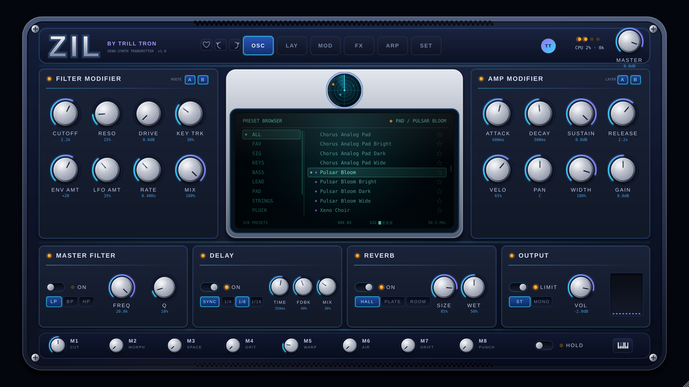

# ZIL — Xeno-Synth Transmitter  *(by Trill Tron)*

A 3-layer rompler / wavetable / FM hybrid instrument plugin (VST3 · AU · Standalone; AAX with the Avid SDK), written in C++17 with JUCE 8.
Preset-first like Nexus, FM8-style depth underneath, and a retro-futurist "signal from space" sound palette.



## Build

Needs CMake ≥ 3.22 and a C++17 compiler. JUCE 8.0.6 is downloaded automatically (or put it in `./JUCE`, or pass `-DJUCE_DIR=`).

```bash
cmake -S . -B build -DCMAKE_BUILD_TYPE=Release
cmake --build build --config Release --parallel
```

Output: `build/ZIL_artefacts/Release/VST3/ZIL.vst3` (and `AU/`, `Standalone/`).

* **FL Studio (Windows):** copy `ZIL.vst3` to `C:\Program Files\Common Files\VST3\`, then *Options → Manage plugins → Find installed plugins*.
  Don't have a Windows machine? Push this folder to GitHub — `.github/workflows/build.yml` builds Windows, macOS (universal, VST3+AU) and Linux artifacts.
* Linux deps: `libasound2-dev libfreetype-dev libx11-dev libxext-dev libxrandr-dev libxinerama-dev libxcursor-dev libgl-dev libfontconfig1-dev`
* AAX: `cmake -DAAX_SDK_PATH=/path/to/aax-sdk ...`
* Fonts: drop `Orbitron.ttf` and `ShareTechMono.ttf` (both SIL OFL) into `Resources/` and rebuild to get the Eurostile-style headings; otherwise system fonts are used.

## Engine

| Layer | Source | Notes |
|---|---|---|
| **A — ROM** | 16 band-limited instrument spectra (grand/felt piano, Rhodes, Wurlitzer, clav, B3, pipe organ, strings, brass, reed, guitar, marimba, kalimba, sub, choir, alien) | mip-mapped tables, no aliasing; own filter + ADSR |
| **B — Wavetable/FM** | sine→tri→saw→square→glass morph, 2 detuned oscillators, phase-mod FM (ratio/amount) | own filter + ADSR |
| **C — Noise/Grain** | coloured noise + 4-grain granular smear | own filter + ADSR |

Shared: **Filter Modifier** (drive + 24 dB LP, key-track, filter ADSR, LFO, A/B layer routing) → **Amp Modifier** (ADSR, velocity, pan, width, gain) →
**sci-fi FX** (formant/vowel, ring-mod, bit-crush, grain smear) → **Master Filter** (LP/BP/HP) → **Delay** (tempo-sync, ping-pong) → **Reverb** (hall/plate/room) → **Output** (limiter, mono/stereo).
Plus tempo-synced **arpeggiator** (5 modes, 16-step gate grid, swing, hold, *evolve* that mutates the grid every bar), 8 macros (CUT MORPH SPACE GRIT WARP AIR DRIFT PUNCH),
mono/legato/glide, mod-wheel vibrato, sustain pedal, pitch-bend, and a **drum keymap** mode (acoustic / electronic / metal / pitched-perc) for the kit presets.

## Presets — 328 factory patches
82 base patches across Keys, Bass, Lead, Pad, Strings, Pluck, Drums, FX, Arp (every name from the design brief, plus the ones in the mock-up),
each in **Normal / Bright / Dark / Wide** flavours. The ★ *signature* tier (violet ◆ in the browser, `SIG` filter) adds a sci-fi processing chain — bit-crush + ring-mod, granular smear, formant, or ring + echo.
Browser: category list, scroll, ★ favourites (saved with the project), ↑/↓ to step, heart icon in the top bar.

## UI
Resizable 16:9 (drag the corner, or SET → UI scale; size is remembered), 6 pages: **OSC** (main) · **LAY** (layers) · **MOD** (filter env, LFO, macro map) · **FX** · **ARP** · **SET**.
3D knobs (drag / scroll / double-click reset / hover tooltip / **right-click MIDI learn**, mappings saved), LED toggles, mouse-tilt parallax (SET → TILT), MIDI-reactive radar ring, hum-bar VU, on-screen keyboard, undo/redo.

## Tests
`ZILTest` (built by default) renders every preset offline and checks for NaN / silence / clipping, round-trips plugin state, checks arp timing and runs the GUI:

```bash
build/ZILTest_artefacts/Release/ZILTest audio out     # all presets, writes sample WAVs
xvfb-run -a build/ZILTest_artefacts/Release/ZILTest state x
xvfb-run -a build/ZILTest_artefacts/Release/ZILTest shots docs 2000 "Pulsar Bloom"
```

## Licence note
JUCE is dual-licensed (AGPLv3 / commercial). Distributing ZIL binaries means either releasing under AGPLv3 or buying a JUCE licence.
VST is a trademark of Steinberg; VST3 SDK is bundled with JUCE under its MIT/GPLv3 terms.
